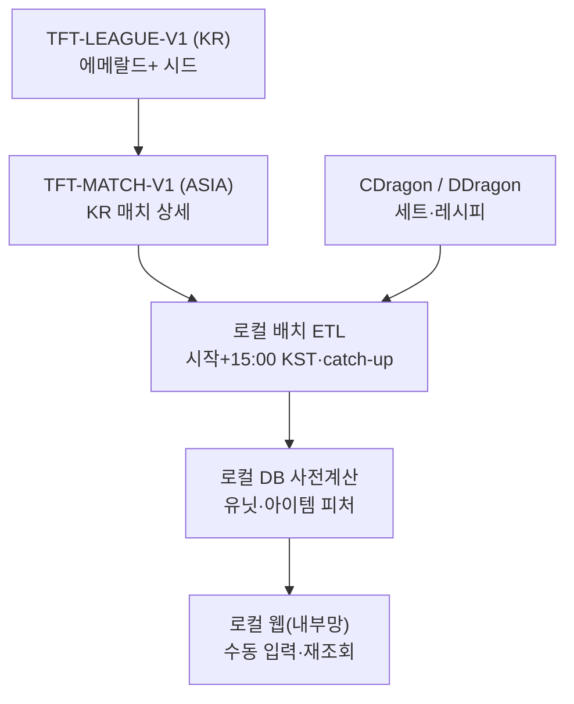

# TFT 뉴비 헬퍼 — PRD

> 로컬·내부망 전용 KR 반응형 웹. 유닛≥2 필수, 아이템·증강 선택. 에메랄드+ 고정 시드. MVP=유닛 추천(Jaccard), 아이템·증강·상징은 이후.

- 제품명: TFT 뉴비 헬퍼
- 작성일: 2026-11-09 (Asia/Seoul)
- 기준 시즌: Set 18 Enchanted Wilds (패치 18.6 전후)
- 미확인 수치는 넣지 않음
- Page 원본(참고): Cursor Canvas `d010f8ac-366c-4591-b68d-2afd444712d9`

## 목차

1. [개요·문제·목표](#1-개요문제목표)
2. [확정 결정](#1b-확정-결정)
3. [타깃 사용자](#2-타깃-사용자)
4. [핵심 시나리오·흐름](#3-핵심-시나리오흐름)
5. [기능 요구사항](#4-기능-요구사항)
6. [추천 로직](#5-추천-로직)
7. [데이터 파이프라인](#6-데이터-파이프라인)
8. [비기능 요구사항](#7-비기능-요구사항)
9. [정책·리스크](#8-정책리스크)
10. [성공 지표·MVP·마일스톤](#9-성공-지표mvp마일스톤)
11. [참고 자료](#참고-자료)

---

## 정책 핵심

> **경고:** Riot TFT 정책상 클라이언트가 보드를 읽어 행동을 지시하는 도구는 비승인 대상입니다. 본 제품은 브라우저 수동 입력 + 복수 후보 제시 웹 헬퍼이며, 오버레이·메모리 읽기·자동 선택은 비목표입니다.

## 1. 개요·문제·목표

### 용어 정의: 실시간

> **정보:** ‘실시간’은 클라이언트 연동이 아닙니다. 판을 플레이하는 동안 보유·의도를 사이트에 직접 입력·갱신하면, 사전 수집·정형 로직으로 미리 계산해 둔 덱 후보를 조회해 참고하는 사용 방식을 뜻합니다.

### 문제

lolchess.gg·tft.op.gg 등은 최종 덱·과정을 잘 보여 주지만, “지금 가진 것”에 맞춰 어느 메타 덱으로 갈지 고르는 초보 의사결정은 직접 돕지 않습니다.

### 제품 한 줄

로컬 머신에서 돌리는 내부망 전용 반응형 웹. 유닛(≥2)·부품/완제·증강(선택)을 수동 입력하면 사전 계산 메타 덱 후보를 빠르게 추천하는 개인 토이프로젝트.

### 목표

- 초보가 판 중·초반에 덱 방향을 스스로 고르게 한다 (대신 선택하지 않음).
- 시나리오 A(MVP): 보유 유닛 → 도달 가능 강덱 Top-N.
- 시나리오 B(이후): 보유 부품/완제 → 해당 아이템을 잘 쓰는 덱 (유닛 추천과 별도 섹션).
- 시나리오 C(이후): 상징/메타 의도 → 관련 강덱 + 추천 점수.
- 시나리오 D: 공식 패치 상향/하향 확인.
- 세트 교체 시 UI는 유지하고 CDragon 등 정적·집계 데이터만 교체 (데이터 드리븐 UI).

### 비목표

- 자동 선택·롤링·장착 자동화, 오버레이·LCU/메모리 추적, 스카우팅.
- 단일 정답 강제, Legend/Legend 증강 승률 표시.
- lolchess/op.gg HTML 스크래핑 1차 소스, 수익화·공인 호스팅·외부 공개 배포(현 단계: 로컬·내부망만).

## 1b. 확정 결정

| 항목 | 결정 |
| --- | --- |
| 플랫폼·배포 | 반응형 웹 · 로컬 실행만 · 내부망 접근만 (공인 호스팅/도메인 없음) |
| 서버/표본 | KR만 (리그: kr.api, 매치: asia). 로컬 서버 + 로컬 DB |
| 입력 게이트 | 유닛 추천: 유닛 ≥2 (미만이면 안내). 아이템 추천(이후): 부품≥3 또는 완제≥1 또는 (완제≥1 ∧ 부품≥1) — 미충족 시 입력 유도 안내. 증강은 선택 |
| 아이템 | 부품·완제 입력 가능. 게이트 충족 시에만 아이템 기준 추천 섹션 활성 |
| 티어 | 에메랄드 이상 고정(Emerald I–IV, Diamond I–IV, Master, Grandmaster, Challenger). UI 티어 필터 없음. TFT-LEAGUE-V1 apex + entries/티어/디비전으로 시드 |
| 표본·갱신 | 매 배치마다 N으로 n_min 재계산·적용. 스케줄: 로컬 프로세스 시작 시 + 매일 15:00 Asia/Seoul (머신 off면 스킵 → 다음 시작 시 catch-up) |
| 클러스터 거리 | Jaccard 확정 (세트 겹침에 적합; 코사인 미채택) |
| 수익화·키 | 수익화 없음, 개인 토이 → Personal API 키. 공개 서비스 금지. 등록은 권장/요구 |
| 제품명 | TFT 뉴비 헬퍼 |
| 세트 교체 | UI 골격 유지, 정적·집계 데이터만 CDragon/배치로 교체 |
| MVP 범위 | 유닛≥2 추천만. 아이템·증강·상징은 이후 |

## 2. 타깃 사용자

| 구분 | 설명 |
| --- | --- |
| 1차 | 초보~중하. 메타 덱은 알지만 내 보드로 노선이 안 잡히는 사람 |
| 2차 | 복귀·새 세트 초반 상징/아이템 실험러 |
| 비타깃 | 챌린저급 실시간 최적화·카운터 도구 |

## 3. 핵심 시나리오·흐름

### 시나리오 A — 유닛 기반 추천 (MVP)

1. **입력** — 챔피언·성급 입력. 유닛 추천은 2개 이상일 때만 실행(미만이면 “유닛을 2개 이상 입력해 주세요” 안내). 아이템·증강은 선택(MVP 점수 미반영 가능). 스테이지 전환 시 짧게 수정.
2. **조회** — 사전 계산 덱과 Jaccard 기반 유닛 겹침으로 Top-N. 요청 시 매치 API 호출 없음.
3. **결과·재조회** — 덱 카드(등수·Top4·유사도·다음 유닛)를 보고 플레이. 보드가 바뀌면 입력 갱신 후 다시 조회.

### 시나리오 B — 아이템 기반 추천 (이후)

유닛 추천과 별도 섹션. 게이트: 부품≥3 또는 완제≥1 또는 (완제≥1 그리고 부품≥1). 미충족 시 추천 대신 입력 유도 안내. 충족 시 보유 부품/완제가 잘 쓰이는 덱을 추천 (예: BF+곡궁, 지팡이+곡궁).

1. **게이트 검사** — 위 조건 불만족이면 안내 문구만 표시하고 아이템 추천 API를 호출하지 않음.
2. **부품→완제 펼치기** — CDragon 레시피로 가능 완제 집합 산출 후, 클러스터 아이템·부품쌍 빈도로 S_item_fit 상위 덱 표시.

### 시나리오 C — 상징 기반 (이후)

원하는 상징 → 관련 강덱 + 추천 점수(단독 성과·상위 덱 빈도 − 증강 다양성 페널티).

### 시나리오 D — 패치 변경점

공식 TFT 패치 노트 기반 챔피언·아이템·증강 상향/하향 리스트.

### 시스템 흐름

## 4. 기능 요구사항

### 4.1 입력 UI

- 유닛: 검색·다중 선택, 성급 — 유닛 추천은 ≥2일 때 활성(미만 안내).
- 아이템: 부품·완제 선택. 아이템 추천 게이트: 부품≥3 | 완제≥1 | (완제≥1∧부품≥1).
- 증강: 0~3 선택 — MVP 이후 가중.
- 상징/의도: 이후 단계.
- 판 중 재입력: 직전 입력 유지 + 빠른 수정.
- 클라이언트 연동 없음. 로컬·내부망만.

### 4.2 결과 — 유닛 추천 (MVP)

| 필드 | 설명 |
| --- | --- |
| 덱/클러스터 | 대표 유닛 구성 라벨 |
| 평균 등수 / Top4율 / 승률 | 승률=placement 1 비율, UI에 정의 표기 |
| 유닛 유사도 | 보유↔핵심 유닛 겹침 |
| 다음 유닛 | 부족한 핵심 유닛 |
| 표본 n | n < n_min이면 노출 제외 |

### 4.3 결과 — 아이템 추천 (이후, 별도 섹션)

- 게이트 충족 시에만 노출. 미충족 시 입력 유도 카피.
- 섹션 제목 예: “보유 아이템으로 잘 가는 덱”.
- 매칭: 부품·완제→레시피 펼침 + 클러스터 아이템/부품쌍 빈도·성과.
- 유닛 추천과 시각적 분리. 표본 n_min 미달 제외.

### 4.4 패치·기타

- 패치 변경점 뷰 (공식 노트).
- 데이터 기준 시각·패치·KR·시드 티어(에메랄드+ 고정) 고지, 콜드스타트 배너.
- 티어 필터 UI 없음 (에메랄드+ 고정).
- Riot 미공식 고지문.

## 5. 추천 로직

> **정보 (가중치·임계는 초안):** 실제 값은 첫 KR 배치 표본을 본 뒤 조정. MVP는 유닛 항만 사용.

### 5.1 덱 클러스터링

KR 에메랄드 이상 랭크 매치 최종 보드를 유닛 집합으로 클러스터링(거리=Jaccard 확정). 클러스터별 대표 유닛·자주 쓰는 완제/부품쌍·증강 분포·등수 통계 저장. 티어 UI 필터 없음.

- 거리: Jaccard (유닛 세트 겹침). 코사인 미사용.
- 매 배치에서 산출한 n_min 미만 클러스터는 노출 제외.

### 5.2 표본 임계 n_min (초안)

전체 유효 참가 보드 수(또는 클러스터링에 쓴 표본)를 N이라 할 때:

$$
n_{\min} = \max\bigl(30,\ \lceil 0.005 \cdot N \rceil\bigr)
\qquad (0)
$$

예: N=10,000이면 n_min=50. 상수 30·비율 0.5%는 초안 공식. 데이터 업데이트(매 배치)마다 N을 다시 세어 n_min을 재계산·적용한다. 미달 항목은 제외(숨김).

### 5.3 유닛 매칭 (MVP)

전제: `|U_units| ≥ 2`. 아니면 추천 생략·안내.

$$
S_{\mathrm{unit}} = \frac{|U_{\mathrm{units}} \cap C_{\mathrm{core}}|}{|C_{\mathrm{core}}|}
\qquad (1)
$$

$$
S_{\mathrm{final}} = w_m\, S_{\mathrm{unit}} + w_p\, S_{\mathrm{perf}}(C)
\qquad (2)
$$

초안: \(w_m=0.65\), \(w_p=0.35\). \(S_{\mathrm{perf}}\)는 등수·Top4 정규화. Top-N(3~5) 복수 노출.

### 5.4 아이템 적합 (이후)

CDragon 레시피로 부품 다중집합 → 완성 가능 아이템 집합 I(U). 클러스터 C의 자주 쓰는 완제·관측 부품쌍과 교집합으로 적합도 계산.

$$
S_{\mathrm{item\_fit}}(U,C) = f\bigl(\mathrm{overlap}(I(U), C_{\mathrm{items}}),\ \mathrm{pair\_hits}(U_{\mathrm{comp}}, C_{\mathrm{pairs}})\bigr)
\qquad (3)
$$

$$
S_{\mathrm{item\_final}} = w_i\, S_{\mathrm{item\_fit}} + w_p\, S_{\mathrm{perf}}(C)
\qquad (4)
$$

게이트(부품≥3 | 완제≥1 | 완제≥1∧부품≥1) 통과 후에만 계산. 예: BF+곡궁 → IE 등이 C에서 고빈도·좋은 등수면 가산. 유닛 추천과 별도 섹션.

### 5.5 상징 점수 (이후)

$$
S_{\mathrm{emblem}}(E) = 100 \cdot (a\, T_{\mathrm{solo}} + b\, F_{\mathrm{top}} - c\, P_{\mathrm{aug}})
\qquad (5)
$$

초안 \(a=0.4\), \(b=0.4\), \(c=0.2\). Legend 승률 미표시.

## 6. 데이터 파이프라인

### 6.1 소스

1. **Riot TFT API (KR)**
   - tft-league-v1 (platform KR): challenger·grandmaster·master + entries/EMERALD|DIAMOND/I–IV (페이지)
   - tft-match-v1 (regional ASIA): match ids·detail
   - Participant: placement, traits, units, augments, items/itemNames
2. **정적 — CDragon 우선 + DDragon**
   - 챔피언·트레잇·증강·아이템·부품→완제 레시피 (세트 교체 시 이 레이어만 교체)
3. **패치 노트 — 공식 TFT 사이트**
   - 버프/너프 추출
4. **참고만 — lolchess.gg / tft.op.gg**
   - UX 레퍼런스. 스크래핑 비1차

### 6.2 티어 시딩 (정확)

매치 DTO에는 로비 티어 필터가 없습니다. TFT-LEAGUE-V1(KR)으로 플레이어를 시드합니다.

1. apex: `GET …/challenger`, `…/grandmaster`, `…/master`
2. 그 아래: `GET …/entries/EMERALD/I|II|III|IV`, `…/entries/DIAMOND/I–IV` (page 쿼리)

LoL용 league-exp-v4가 아니라 TFT 전용 tft-league-v1 entries입니다. 수집 범위=에메랄드 이상 고정(뉴비 메타·표본). UI 티어 필터 없음. 각 puuid의 최근 랭크 매치는 ASIA 매치 API로 조회합니다.

### 6.3 API 키 (토이프로젝트)

| 키 | 문서 한도 | 본 프로젝트 |
| --- | --- | --- |
| Personal | 20/1초, 100/2분 (리전별) | 현재 적합. 개인·비공개. 공개 서비스·오픈알파에 사용 금지 |
| Production | 500/10초, 30k/10분 (리전별) | 불특정 다수 공개 시 필요. 프로토타입·승인 절차 |
| Development | 임시, 24h 만료 | 스파이크용만. 유지 운영에 부적합 |

Personal 한도 안에서 KR 에메랄드+·일 1회 배치로 설계. 한도 초과 시 페이지 수·매치 수·하위 디비전부터 수집량을 줄인다(범위 목표는 에메랄드+ 유지).

### 6.4 배치·사전 계산

1. **스케줄 (로컬)** — 로컬 머신에서 프로세스 시작 시 1회 + 매일 15:00 Asia/Seoul. 머신이 꺼져 15:00을 놓치면 스킵되고, 다음 시작 시 catch-up 배치. 패치 당일 수동 실행 가능.
2. **수집·정제** — 리그 시드 → 매치 → 랭크 큐·세트 필터, 아이템 id 매핑. 결과는 로컬 DB에 저장.
3. **집계** — Jaccard 클러스터, 통계, 이번 배치 N으로 n_min 재계산·적용.
4. **사전 계산 테이블** — 유닛→후보 덱 역인덱스(MVP). 이후: 부품쌍/완제→후보 덱, 상징→덱.

## 7. 비기능 요구사항

| 항목 | 내용 |
| --- | --- |
| 추천 응답 | 로컬 DB 사전계산 조회 p95 < 300ms — 목표 |
| 배포 | 로컬 서버·로컬 DB·내부망만. 공인 인터넷 호스팅/도메인 없음 |
| 범위 | KR · 에메랄드+ 고정 · 반응형 웹 |
| 갱신 | 로컬 시작 시 + 매일 15:00 KST. off 시 스킵→시작 catch-up. 실패 시 직전 스냅샷 |
| 표본 | 매 배치 n_min 재계산. n < n_min 제외. 콜드스타트 배너 |
| 개인정보 | 비로그인. 집계용 puuid는 로컬 배치만 |
| 언어 | UI 한국어 |
| 세트 전환 | UI 고정, 정적·집계 데이터 핫스왑 |

## 8. 정책·리스크

- 수동 입력·복수 후보·비오버레이로 정책 정합. ‘실시간’=판 중 상태 반영 조회.
- 수익화 없음·토이 → Personal 키. 공개 확산 시 Production으로 전환·등록.
- Personal 한도 → 에메랄드+ 유지하되 페이지/매치 수 조절. 로컬·내부망만이라 공개 배포 리스크 낮음.
- 세트 교체는 데이터 교체만(하드코딩 챔프명 지양).
- 스크래핑 비1차. Legend 승률 금지.

## 9. 성공 지표·MVP·마일스톤

### 성공 지표 (초안)

- 주간 유닛 추천 완료 수
- 본인 체감(간단 메모/설문)
- 노출 클러스터 평균 n, 15:00 배치 성공률
- 오버레이/자동화 0

### MVP

- [ ] KR 에메랄드+ 수집 + 유닛 클러스터 + n_min 필터 *(MVP)*
- [ ] 로컬 웹: 유닛≥2 게이트 + Top-N 유닛 추천(Jaccard) *(MVP)*
- [ ] 로컬 시작·15:00 KST 배치 + catch-up·매 배치 n_min *(MVP)*
- [ ] 패치 변경점 뷰 (간단) *(MVP)*
- [ ] 미공식 고지·Personal 키·제품 등록(개인) *(MVP)*
- [ ] 아이템 게이트(부품3|완제1|완제1+부품1) + 별도 추천 섹션 *(이후)*
- [ ] 증강 가중·상징 점수 *(이후)*

### 마일스톤

| 단계 | 내용 | 기간 |
| --- | --- | --- |
| M0 | PRD 확정(본 개정), Personal 키·등록 | 완료 임박 |
| M1 | KR 리그 시드 + 매치 PoC, CDragon 로드 | 1~2주 |
| M2 | 유닛 클러스터·S_unit·n_min·15:00 배치 | 2주 |
| M3 | 로컬 MVP UI (유닛≥2 추천 + 패치 뷰, 내부망) | 2주 |
| M4 | 아이템 조합 추천 섹션 + (선택) 증강/상징 | 이후 |

## 참고 자료

1. [Riot TFT Docs (정책·DDragon)](https://developer.riotgames.com/docs/tft) — developer.riotgames.com
2. [Developer Portal (Personal/Production 키)](https://developer.riotgames.com/docs/portal) — developer.riotgames.com
3. [TFT-LEAGUE-V1 API](https://developer.riotgames.com/apis#tft-league-v1) — developer.riotgames.com
4. [Community Dragon TFT](https://raw.communitydragon.org/latest/cdragon/tft/) — raw.communitydragon.org
5. [TFT patch 18.6](https://teamfighttactics.leagueoflegends.com/en-us/news/game-updates/teamfight-tactics-patch-18-6/) — teamfighttactics.leagueoflegends.com (2026-11-03)

---

*이 문서는 Cursor Page PRD를 Markdown으로 옮긴 것이며, 구현 시 `TASKS.md`의 MVP 체크리스트를 따른다.*
