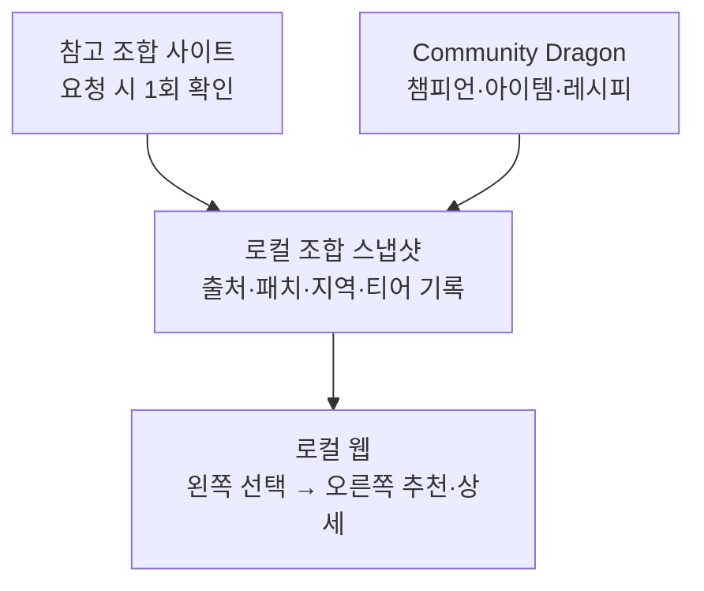

# TFT 뉴비 헬퍼 — PRD

> 로컬·내부망 전용 한국어 반응형 웹. 왼쪽에서 챔피언·아이템을 고르고 오른쪽에서 추천 덱을 확인한다. 조합 데이터는 사용자가 요청할 때만 갱신한 로컬 스냅샷을 사용한다. Riot API는 사용하지 않는다.

- 제품명: TFT 뉴비 헬퍼
- 작성일: 2026-11-09 (Asia/Seoul)
- 기준 시즌: Set 18 Enchanted Wilds (패치 18.6 전후)
- 미확인 수치는 넣지 않음
- Page 원본(참고): Cursor Canvas `d010f8ac-366c-4591-b68d-2afd444712d9`

## 목차

1. [개요·문제·목표](#1-개요문제목표)
2. [확정 결정](#1b-확정-결정)
3. [타깃 사용자](#2-타깃-사용자)
4. [핵심 시나리오·흐름](#3-핵심-시나리오흐름)
5. [기능 요구사항](#4-기능-요구사항)
6. [추천 로직](#5-추천-로직)
7. [데이터 파이프라인](#6-데이터-파이프라인)
8. [비기능 요구사항](#7-비기능-요구사항)
9. [정책·리스크](#8-정책리스크)
10. [성공 지표·MVP·마일스톤](#9-성공-지표mvp마일스톤)
11. [참고 자료](#참고-자료)

---

## 정책 핵심

> **경고:** Riot TFT 정책상 클라이언트가 보드를 읽어 행동을 지시하는 도구는 비승인 대상입니다. 본 제품은 브라우저 수동 입력 + 복수 후보 제시 웹 헬퍼이며, 오버레이·메모리 읽기·자동 선택은 비목표입니다.

## 1. 개요·문제·목표

### 용어 정의: 실시간

> **정보:** ‘실시간’은 클라이언트 연동이 아닙니다. 판을 플레이하는 동안 보유·의도를 사이트에 직접 입력·갱신하면, 사전 수집·정형 로직으로 미리 계산해 둔 덱 후보를 조회해 참고하는 사용 방식을 뜻합니다.

### 문제

lolchess.gg·tft.op.gg 등은 최종 덱·과정을 잘 보여 주지만, “지금 가진 것”에 맞춰 어느 메타 덱으로 갈지 고르는 초보 의사결정은 직접 돕지 않습니다.

### 제품 한 줄

로컬 머신에서 돌리는 내부망 전용 반응형 웹. 유닛(≥1)·부품/완제·증강(선택)을 수동 입력하면 사전 계산 메타 덱 후보를 빠르게 추천하는 개인 토이프로젝트.

### 목표

- 초보가 판 중·초반에 덱 방향을 스스로 고르게 한다 (대신 선택하지 않음).
- 시나리오 A(MVP): 보유 유닛 1개 이상 → 조합 목록에서 맞는 덱 Top-N.
- 시나리오 B(MVP): 보유 부품/완제 → 해당 아이템을 잘 쓰는 덱 (유닛 추천과 별도 섹션).
- 시나리오 C(이후): 상징/메타 의도 → 관련 강덱 + 추천 점수.
- 시나리오 D: 공식 패치 상향/하향 확인.
- 세트 교체 시 UI는 유지하고 CDragon 등 정적·집계 데이터만 교체 (데이터 드리븐 UI).

### 비목표

- 자동 선택·롤링·장착 자동화, 오버레이·LCU/메모리 추적, 스카우팅.
- 단일 정답 강제, Legend/Legend 증강 승률 표시.
- Riot API 연동, 자동·정기 수집, 수익화·공인 호스팅·외부 공개 배포(현 단계: 로컬·내부망만).

## 1b. 확정 결정

| 항목 | 결정 |
| --- | --- |
| 플랫폼·배포 | 반응형 웹 · 로컬 실행만 · 내부망 접근만 (공인 호스팅/도메인 없음) |
| 서버/데이터 | 로컬 서버 + 로컬 DB. 조합 출처의 지역·티어·패치·갱신 시각을 함께 표시 |
| 입력 게이트 | 유닛 추천: 유닛 ≥1 (미선택이면 안내). 아이템 추천: 부품≥3 또는 완제≥1 — 미충족 시 입력 유도 안내. 증강은 선택 |
| 아이템 | 부품·완제 입력 가능. 게이트 충족 시에만 아이템 기준 추천 섹션 활성 |
| 티어 | 저장한 조합 스냅샷의 출처 기준을 표시. 참고 OP.GG 페이지의 18.6 조합은 글로벌·플래티넘+이며 KR 에메랄드+로 표기하지 않음 |
| 갱신 | 사용자가 요청할 때만 조합·정적 데이터를 수동 갱신. 앱 시작 및 15:00 자동 실행 없음 |
| 유닛 거리 | 저장된 조합과 보유 유닛의 겹침으로 순위 산정. Jaccard는 유닛 집합 비교에 사용 가능 |
| 수익화·키 | 수익화 없음. Riot API 키 불필요 |
| 제품명 | TFT 뉴비 헬퍼 |
| 세트 교체 | UI 골격 유지, CDragon 정적 데이터와 조합 스냅샷을 수동 교체 |
| MVP 범위 | 챔피언·아이템 클릭 선택, 추천 덱 목록·펼침 상세, 공식 패치 노트. 증강 가중·상징 점수는 이후 |

## 2. 타깃 사용자

| 구분 | 설명 |
| --- | --- |
| 1차 | 초보~중하. 메타 덱은 알지만 내 보드로 노선이 안 잡히는 사람 |
| 2차 | 복귀·새 세트 초반 상징/아이템 실험러 |
| 비타깃 | 챌린저급 실시간 최적화·카운터 도구 |

## 3. 핵심 시나리오·흐름

### 시나리오 A — 유닛 기반 추천 (MVP)

1. **입력** — 챔피언·성급 입력. 유닛을 1개 이상 선택하면 추천을 실행한다. 아이템·증강은 선택(MVP 점수 미반영 가능). 스테이지 전환 시 짧게 수정.
2. **조회** — 로컬에 저장한 조합의 챔피언과 보유 유닛 겹침으로 Top-N을 자동 갱신한다.
3. **결과·재조회** — 오른쪽 덱 목록에서 후보를 클릭해 구성 챔피언·추천 아이템·출처 통계를 펼쳐 본다. 보드가 바뀌면 입력을 수정하고 즉시 다시 비교한다.

### 시나리오 B — 아이템 기반 추천 (MVP)

유닛 추천과 별도 섹션. 게이트: 부품≥3 또는 완제≥1 또는 (완제≥1 그리고 부품≥1). 미충족 시 추천 대신 입력 유도 안내. 충족 시 보유 부품/완제가 잘 쓰이는 덱을 추천 (예: BF+곡궁, 지팡이+곡궁).

1. **게이트 검사** — 위 조건 불만족이면 안내 문구만 표시하고 아이템 추천을 조회하지 않음.
2. **부품→완제 펼치기** — CDragon 레시피로 만들 수 있는 완제 집합을 산출한 뒤, 저장된 조합의 핵심 아이템과 비교해 별도 덱 목록을 표시.

### 시나리오 C — 상징 기반 (이후)

원하는 상징 → 관련 강덱 + 추천 점수(단독 성과·상위 덱 빈도 − 증강 다양성 페널티).

### 시나리오 D — 패치 변경점

공식 TFT 패치 노트 기반 챔피언·아이템·증강 상향/하향 리스트.

### 시스템 흐름

## 4. 기능 요구사항

### 4.1 입력 UI

- 유닛: 검색·다중 선택, 성급, 코스트(전체/1~5)와 상징·특성 필터. 챔피언 이미지 테두리는 코스트별 색으로 표시 — 유닛 1개 이상 선택 시 추천.
- 아이템: 부품·완제 선택. 아이템 추천 게이트: 부품≥3 | 완제≥1 | (완제≥1∧부품≥1).
- 증강: 0~3 선택 — MVP 이후 가중.
- 상징/의도: 이후 단계.
- 판 중 재입력: 직전 입력 유지 + 빠른 수정.
- 클라이언트 연동 없음. 로컬·내부망만.
- 데스크톱은 **2열**: 왼쪽에 챔피언·아이템 검색/클릭 선택과 보유 목록, 오른쪽에 추천 덱 목록. 덱을 클릭하면 같은 자리에서 상세(전체 챔피언, 핵심 아이템, 유사도, 출처 통계)를 펼침/접음.
- 좁은 화면은 선택 영역 위·추천 영역 아래의 1열로 전환. 선택 변경 시 오른쪽 순위를 자동 갱신.

### 4.1.1 시각 디자인 참고 — TFT.OP.GG

TFT.OP.GG의 [추천 조합 화면](https://tft.op.gg/ko/meta-trends/comps?version=set18-v38&runId=20261109T180319Z)을 UI 레퍼런스로 삼는다. 원본 사이트의 코드나 스타일시트를 복사하지 않고, 아래 시각적 패턴만 제품의 2열 구조와 한국어 UI에 맞게 적용한다.

- **캐릭터 이미지:** CDragon에서 제공하는 세트 데이터의 챔피언 아이콘을 사용한다. 선택 목록은 정사각형 초상화 타일로 만들고 코스트별 테두리 색을 유지한다. 추천 덱 상세는 초상화를 이름과 함께 나열한다. 이미지가 없거나 로드에 실패하면 챔피언 이름을 표시해 정보가 사라지지 않게 한다.
- **캐릭터 표현:** 덱 카드 안에서 핵심 유닛을 앞쪽에 배치하고 각 유닛의 성급을 별로 표시한다. 각 유닛 아래 또는 옆에 핵심 아이템 아이콘을 최대 3개씩 붙여 아이템이 누구에게 배정되는지 한눈에 구분한다. 나머지 유닛은 같은 크기의 초상화 타일로 구성한다.
- **시너지 표현:** 특성은 작은 색상 칩으로 묶어 표시하고, 활성 수치와 특성명을 함께 적는다. 챔피언 코스트 색과 특성 색은 서로 다른 의미로 유지한다.
- **추천 카드:** 카드 상단에는 덱 이름, 티어 배지와 간단한 운영 난이도를 둔다. 확장 상세에는 평균 등수·픽률·승률·순방률·게임 수를 같은 그룹으로 정리하고, 출처의 패치·지역·티어 조건을 명시한다.
- **타이포그래피:** 한글 가독성이 높은 시스템 산세리프를 기본으로 한다. 제목은 굵기와 크기로 단계화하고, 통계 숫자는 정렬이 흐트러지지 않도록 고정폭 숫자(tabular numerals)를 사용한다. 작은 보조 문구도 충분한 대비와 읽을 수 있는 크기를 유지한다.
- **시각 톤:** 정보 밀도가 높은 다크 대시보드, 절제된 경계선과 간격, 카드 단위 그룹화를 참고한다. 배경·카드·선택·강조 색을 구분하되, OP.GG 로고나 고유 브랜드 자산을 복제하지 않는다.

이 레퍼런스는 시각적 가이드이며, OP.GG의 실시간 기능이나 자체 데이터를 제품에 연결하라는 요구가 아니다. 조합 정보의 출처 및 갱신 정책은 6장의 수동 스냅샷 규칙을 따른다.

### 4.2 결과 — 유닛 추천 (MVP)

| 필드 | 설명 |
| --- | --- |
| 덱 | 저장된 조합 이름과 전체 챔피언 구성 |
| 평균 등수 / Top4율 / 승률 | 출처에서 제공된 경우에만 출처·지역·티어·패치와 함께 표시. 승률은 1등 비율 |
| 유닛 유사도 | 보유↔핵심 유닛 겹침 |
| 다음 유닛 | 부족한 핵심 유닛 |
| 표본 n | 출처에서 제공된 경우 표시. 자체 계산 표본으로 오인하지 않게 출처 표기 |

### 4.3 결과 — 아이템 추천 (MVP, 별도 섹션)

- 게이트 충족 시에만 노출. 미충족 시 입력 유도 카피.
- 섹션 제목 예: “보유 아이템으로 잘 가는 덱”.
- 매칭: 부품·완제→레시피 펼침 + 저장된 조합의 핵심 아이템과 일치도.
- 유닛 추천과 시각적 분리. 표본 n_min 미달 제외.

### 4.4 패치·기타

- 패치 변경점 뷰 (공식 노트).
- 데이터 기준 시각·패치·출처·출처의 지역/티어 고지, 조합 데이터가 없을 때 안내 배너.
- 현재 스냅샷의 지역/티어를 사실대로 표시하고, 별도 필터 UI는 두지 않음.
- Riot 미공식 고지문.

## 5. 추천 로직

> **정보:** 아래 점수는 로컬 조합 스냅샷을 정렬하기 위한 기준이다. 출처의 승률·표본과 자체 추천 점수는 구분해서 표시한다.

### 5.1 덱 목록

사용자가 지정한 참고 사이트의 공개 조합을 요청 시 확인해 로컬 스냅샷으로 저장한다. 조합별 이름·전체 유닛·핵심 아이템·출처 링크·패치·지역·티어·기준 시각을 기록한다. 제공된 통계는 출처 수치로만 취급한다.

- 유닛 집합 유사도는 Jaccard로 계산할 수 있다.
- 원본에 없는 표본 수·승률은 생성하지 않는다. 조합 스냅샷이 비어 있으면 추천 대신 안내한다.

### 5.2 유닛 매칭

전제: 보유 챔피언 1개 이상. 보유 집합 U와 조합 챔피언 집합 C의 유사도로 상위 3~5개 조합을 정렬하고, 선택 유닛과 하나 이상 겹치는 덱을 후보로 표시한다.

$$
S_{\mathrm{unit}} = \frac{|U \cap C|}{|U \cup C|}
$$

표본 임계 `n_min`은 자체 매치 표본을 수집하지 않으므로 적용하지 않는다. 출처가 표본을 제공하면 상세에 함께 표시한다.

### 5.3 아이템 매칭

완제 1개 이상 또는 부품 3개 이상일 때 별도 아이템 추천 목록을 활성화한다. CDragon 레시피로 만들 수 있는 완제와 보유 완제를 저장된 조합의 핵심 아이템에 대조한다. 일치하는 아이템과 아직 부족한 재료를 상세에 표시한다.

$$
S_{\mathrm{item}} = \frac{|I(U) \cap I(C)|}{|I(C)|}
$$

출처 통계는 추천 점수에 섞지 않고 상세에 표시한다.

### 5.4 증강·상징 (이후)

증강 가중·상징 점수는 후속 단계에서 정의한다. Legend 승률은 표시하지 않는다.

## 6. 데이터 파이프라인

### 6.1 소스

1. **조합 스냅샷 — 사용자가 지정한 참고 사이트**
   - 현재 참고: [LoLCHESS 세트 18 메타 통계](https://lolchess.gg/decks?hl=ko). 브라우저에서 확인한 전체 유닛 구성과 제공 통계를 로컬 스냅샷으로 저장한다.
   - 현재 스냅샷은 패치 18.6, 글로벌, 마스터+ 기준이다. 이를 KR 에메랄드+ 통계로 표기하지 않는다. 자동·정기 수집은 하지 않고 사용자가 원할 때 브라우저에서 확인해 갱신한다.
2. **정적 — Community Dragon**
   - 챔피언·아이템 이름/이미지·부품→완제 레시피. 새 세트는 데이터를 교체한다.
3. **패치 노트 — 공식 TFT 사이트**
   - 최신 게시물 1개의 변경점과 출처 링크.

### 6.2 수동 갱신

1. 사용자가 갱신을 요청하면 출처 페이지의 패치·지역·티어와 조합 구성을 확인한다.
2. 챔피언·아이템 이름을 CDragon 식별자에 연결하고 검토된 스냅샷을 로컬 DB에 저장한다.
3. 갱신이 실패하면 직전 스냅샷을 유지한다. 앱 시작, 매일 15:00, catch-up 수집은 실행하지 않는다.
4. 추천 조회는 로컬 데이터만 읽으며 외부 사이트에 요청하지 않는다.

## 7. 비기능 요구사항

| 항목 | 내용 |
| --- | --- |
| 추천 응답 | 로컬 DB 사전계산 조회 p95 < 300ms — 목표 |
| 배포 | 로컬 서버·로컬 DB·내부망만. 공인 인터넷 호스팅/도메인 없음 |
| 범위 | 로컬·내부망 반응형 웹. 통계의 지역·티어는 스냅샷 출처 기준 |
| 갱신 | 사용자 요청 시 수동 1회. 실패 시 직전 스냅샷 유지 |
| 데이터 없음 | 조합 스냅샷이 없으면 안내 배너 표시 |
| 개인정보 | 비로그인. Riot 계정 식별자 수집 없음 |
| 언어 | UI 한국어 |
| 세트 전환 | UI 고정, CDragon 데이터·조합 스냅샷 수동 교체 |

## 8. 정책·리스크

- 수동 입력·복수 후보·비오버레이로 정책 정합. ‘실시간’=판 중 상태 반영 조회.
- 출처 사이트의 이용 조건·데이터 재사용 허용 범위를 확인한다. 원본 통계를 표시할 때 출처·집계 조건을 함께 표시한다.
- 외부 조합은 패치가 바뀌면 오래될 수 있으므로 갱신 시각을 명확히 보인다.
- 세트 교체는 데이터 교체만(하드코딩 챔프명 지양).
- Legend 승률 금지.

## 9. 성공 지표·MVP·마일스톤

### 성공 지표 (초안)

- 주간 유닛 추천 완료 수
- 본인 체감(간단 메모/설문)
- 수동 갱신 성공 여부와 스냅샷 기준 시각
- 오버레이/자동화 0

### MVP

- [ ] 출처·패치·지역·티어가 기록된 조합 스냅샷 수동 저장 *(MVP)*
- [ ] 로컬 웹: 왼쪽 챔피언·아이템 선택, 오른쪽 Top-N 덱 목록·클릭 상세 *(MVP)*
- [ ] 유닛≥1 매칭과 별도 아이템 추천, 선택 변경 시 자동 갱신 *(MVP)*
- [ ] 패치 변경점 뷰 (간단) *(MVP)*
- [ ] Riot 미공식 고지·조합 출처 및 집계 조건 표시 *(MVP)*
- [ ] 증강 가중·상징 점수 *(이후)*

### 마일스톤

| 단계 | 내용 | 기간 |
| --- | --- | --- |
| M0 | PRD 확정·조합 출처 검토 | 완료 임박 |
| M1 | 조합 스냅샷 1회 저장·CDragon 식별자 연결 | 우선 |
| M2 | 유닛·아이템 매칭과 로컬 추천 | 다음 |
| M3 | 2열 UI·클릭 상세·패치 뷰 | 다음 |
| M4 | 증강 가중·상징 점수 | 이후 |

## 참고 자료

1. [TFT.OP.GG 세트 18 추천 조합](https://tft.op.gg/ko/meta-trends/comps?version=set18-v38&runId=20261109T180319Z) — 조합 및 카드 표현·이미지 배치·시너지·통계 UI 참고
2. [Community Dragon TFT](https://raw.communitydragon.org/latest/cdragon/tft/) — 챔피언·아이템 정적 데이터
3. [TFT 공식 패치 노트](https://teamfighttactics.leagueoflegends.com/ko-kr/news/tags/patch-notes/) — 변경점

---

*이 문서는 수동 조합 스냅샷·2열 UI 결정에 맞춰 개정했다. 기존 `TASKS.md`는 이전 Riot API 계획이므로 구현 전 별도 갱신이 필요하다.*
